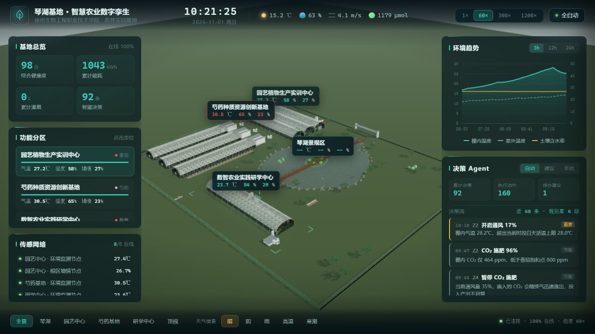
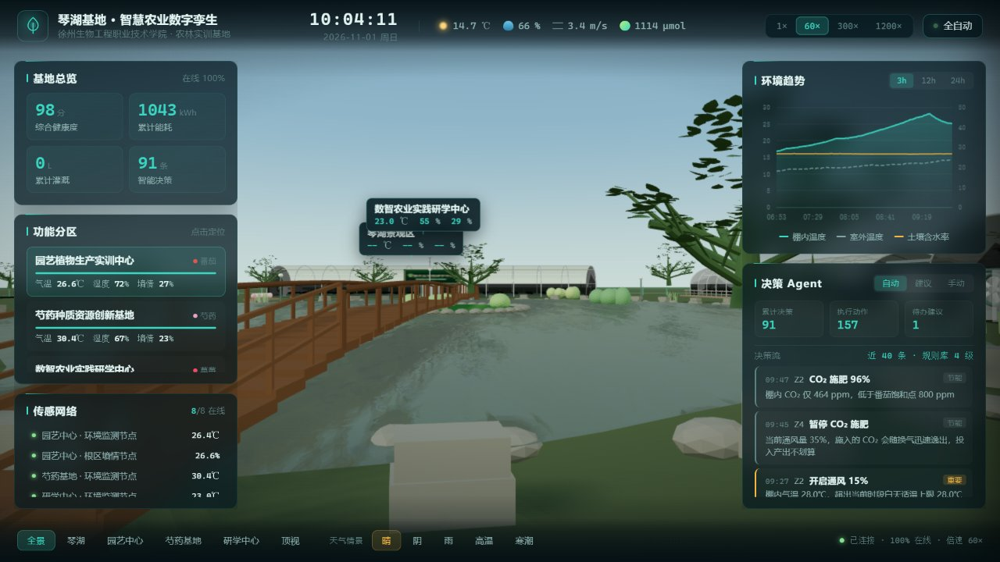
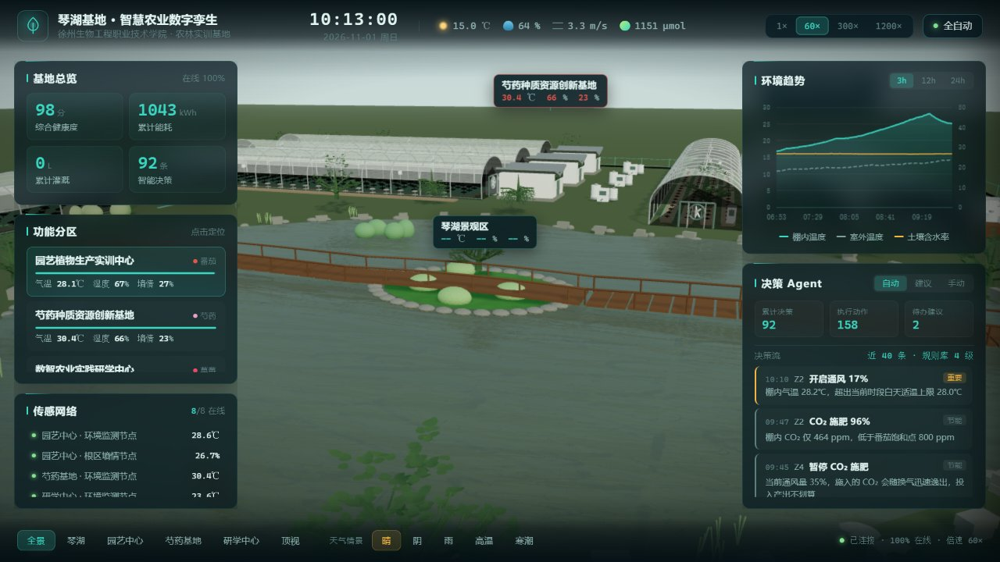
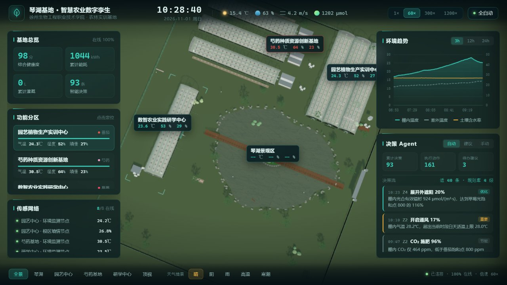
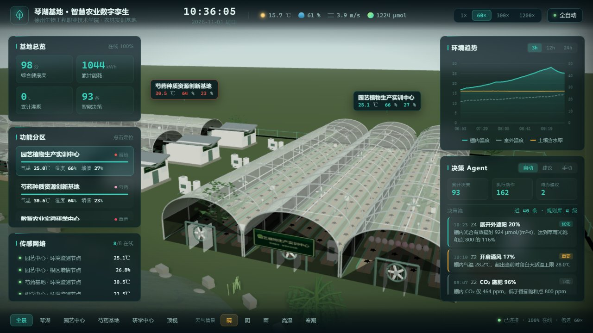
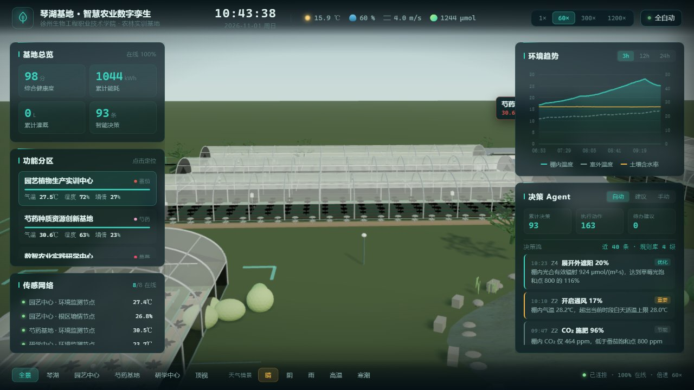

# 琴湖基地 · 智慧农业数字孪生系统

> 徐州生物工程职业技术学院 · 农林实训基地（琴湖基地）
> 一套基于 **Web 三维 + 降阶物理模型 + 可解释决策 Agent** 的可运营数字孪生系统。

<p align="center">
  <b>运行效果视频（约 57 秒，含完整大屏、三维漫游、分区聚焦、实时决策）</b><br>
  <a href="https://github.com/xushanzhizhang/DigitalTwin_QinHuBase/releases/download/v0.1.0/demo.mp4">
    
  </a><br>
  <b>点击上方封面图即可下载视频（约 3.7 MB），下载后双击即可播放。</b><br>
  其他查看方式：
  <a href="https://github.com/xushanzhizhang/DigitalTwin_QinHuBase/releases/download/v0.1.0/demo.mp4">Release 视频直链</a>
  ·
  <a href="docs/demo.mp4">仓库内视频文件</a>
</p>

---

## 一、项目背景与定位

琴湖基地是学校农林类专业的实训场地。本项目不是做一个"好看的三维大屏"，而是给这块
**真实的基地建一套可运营的数字孪生**，让计算机专业技术与学校农业特色深度结合：

> 现场有什么（三维模型）→ 现在什么状态（传感器）→ 为什么是这个状态（物理模型）
> → 该怎么做（决策 Agent）→ 做完什么效果（回写模型并留痕）

普通三维可视化止步于第二步，本项目的差别在后三步。核心理念是：
**模型是载体，数据是主线，决策是价值点**。

### 五个分区

| 分区 | 名称 | 作物 | 类型 |
|---|---|---|---|
| Z1 | 琴湖景观区 | — | 水体 + 气象站 |
| Z2 | 园艺植物生产实训中心 | 番茄 | 三连栋薄膜温室 |
| Z3 | 芍药种质资源创新基地 | 芍药 | 三栋低拱棚 |
| Z4 | 数智农业实践研学中心 | 叶菜（水培） | 砖墙 + 膜温室 |
| Z5 | 露地栽培与苗床区 | 草莓 | 露地 |

---

## 二、核心亮点

1. **真正的闭环，而不是三张皮。** Agent 开了风机，下周期棚温真的会降、风机真的在转、
   决策流里有记录——三者是同一条因果链，而不是三份互不相干的数据。
2. **模拟器是降阶物理模型，不是随机数。** 天气用 OU 均值回复过程，温室做一阶能量 +
   水汽 + CO₂ 平衡，土壤做双层水量平衡，水体有热惯性；太阳位置、晴空 GHI、饱和水汽压、
   VPD、露点、Hargreaves ET₀ 均为真实公式，数据"看着像真的"有物理依据。
3. **决策 Agent 可解释、不抖动。** 每条决策带触发依据、农艺依据、预期效果；有冲突消解、
   死区、指令量化（5% 档）、最短保持时间保护执行机构，并做留痕节流。
4. **离线可用、无构建步骤、一键启动。** Three.js、ECharts、GLTFLoader 全部本地 vendor，
   校园受限网络也能跑；前端原生 ES 模块，无需 npm；后端 FastAPI，`start.bat` 拉起即可。
5. **配置即单一事实来源。** 场地、分区、传感器节点、执行器、作物农艺参数集中在
   `backend/config.py`，前后端共用，坐标口径一致。

---

## 三、系统架构

```
┌──────────────────────────────────────────────────────────────┐
│  展示层   Web 大屏（Three.js + ECharts）                       │
│          三维孪生场景、KPI、趋势曲线、决策流、控制台            │
└───────────────▲──────────────────────────┬───────────────────┘
                │ WebSocket 帧（8 Hz）      │ 控制指令
┌───────────────┴──────────────────────────▼───────────────────┐
│  服务层   FastAPI + Uvicorn                                    │
│          REST：站点配置、历史曲线、决策检索、传感器注册          │
│          WS  ：实时帧推送、决策事件                             │
│          存储：SQLite 时序表（采样 60 s 落盘）                  │
└───────────────▲──────────────────────────┬───────────────────┘
                │ 状态快照                  │ 指令
┌───────────────┴──────────────────────────▼───────────────────┐
│  孪生内核                                                      │
│  ├ 传感器接口层  SensorSource 抽象（模拟 / Modbus / MQTT / HTTP）│
│  ├ 物理模型层    太阳辐射、蒸散、湿度换算、温室能量与水量平衡     │
│  ├ 模拟器        5 个分区状态推进（昼夜节律 + 天气过程）         │
│  └ 决策 Agent    规则库 + 冲突消解 + 死区/保持时间 + 留痕        │
└───────────────▲──────────────────────────────────────────────┘
                │ glb 资产
┌───────────────┴──────────────────────────────────────────────┐
│  模型层   qinhu_base_digital_twin.glb + scene_manifest.json    │
└──────────────────────────────────────────────────────────────┘
```

**一个控制周期的数据流：**

```
模拟器/真实传感器 → 状态快照 → 决策 Agent 评估
        → 生成指令（含依据与预期）→ 写回执行器状态
        → 下一周期状态变化 → 通过 WS 推到大屏 → 驱动模型构件
```

---

## 四、技术栈

| 层 | 技术 | 说明 |
|---|---|---|
| 前端 | Three.js r160、ECharts 5、原生 ES Modules | 依赖全部本地 vendor，无构建、无 npm |
| 后端 | Python 3.10+、FastAPI、Uvicorn | 异步 REST + WebSocket |
| 数据 | SQLite | 内置时序表，零外部数据库依赖 |
| 模型 | GLB（glTF 2.0）+ JSON manifest | Blender 建模，命名即接口 |
| 渲染特性 | ACES 色调映射、PCFSoft 阴影、自定义水面着色器、平面反射 | 天空随仿真时刻变化（日出日落/雨天/星空） |

---

## 五、快速开始

### 方式一：一键启动（Windows，推荐）

1. 确认已安装 **Python 3.10 及以上**并加入 PATH；
2. 双击项目根目录的 **`start.bat`**；
3. 脚本会自动检查并安装依赖（首次运行），随后启动服务并打开浏览器。

启动后访问：

- 完整大屏：<http://127.0.0.1:8848/>
- 纯模型页：<http://127.0.0.1:8848/model.html>

### 方式二：手动启动

```bash
# 1.（可选）创建虚拟环境
python -m venv .venv
# Windows 激活：.venv\Scripts\activate

# 2. 安装依赖
python -m pip install -r requirements.txt

# 3. 启动服务
python -m uvicorn backend.app:app --host 127.0.0.1 --port 8848
```

然后浏览器打开 <http://127.0.0.1:8848/>。

### 环境变量（可选，用于演示与截图）

| 变量 | 说明 | 默认 |
|---|---|---|
| `TWIN_START_HOUR` | 锁定仿真起始时刻（0–23，可小数，如 `9` 表示上午 9 点） | 跟随真实时间 |
| `TWIN_SPEED` | 仿真倍速（0–3600） | 60 |
| `TWIN_SEED_HOURS` | 启动时回放多少小时历史，保证打开即有曲线 | 24 |
| `TWIN_DB` | SQLite 路径 | `data/twin.db` |

> 说明：当真实时间落在 07:00–17:00 之外时，系统会自动把仿真起点挪到当天 09:30，
> 保证打开大屏就是明亮白天，避免深夜一片漆黑、讲解效果差。

---

## 六、界面截图

### 1. 大门第一视角（自东向西，进门第一眼）



### 2. 湖桥景观



### 3. 鸟瞰全景（5 分区整体布局）


### 4. 顶视布局



### 5. 园艺温室（三连栋、内部作物行、风机、控制柜）



### 6. 芍药种质基地



---

## 七、决策 Agent 与规则库

### 设计原则

- **可解释**：每条决策带触发依据（当前值 vs 阈值）、农艺依据、预期效果；
- **不抖**：死区 + 最短保持时间 + 指令量化，避免执行器反复动作；
- **有优先级**：紧急（防冻、防热害）> 重要（通风、遮阳）> 优化（补光、CO₂）> 节能；
- **留痕节流**：同一分区同一执行器 30 分钟内不重复记录，信息流不被淹没。

### 规则一览

| 规则 | 触发 | 动作 |
|---|---|---|
| R1 通风 | 棚温超适温上限 / RH>88% | 卷膜开度 |
| R2 湿帘风机 | 棚温超上限且外温低于棚温 | 湿帘开度（蒸发降温） |
| R3 外遮阳 | 冠层辐射超阈值 | 遮阳网开度 |
| R4 加温 | 低于绝对下限 / 适温下限 | 加温档位（防冻优先） |
| R5 补光 | 光积累不足（DLI 缺口） | 补光强度 |
| R6 灌溉 | 根区含水率低于 MAD 下限 | 按水分亏缺滴灌（不按固定周期） |
| R7 休眠期管理 | 芍药休眠期 | 控水、排湿、不加温 |

### 三维孪生绑定

| 数据 | 驱动的模型构件 | 表现 |
|---|---|---|
| 通风/湿帘开度 | 排风机叶片 | 转速随开度变化 |
| 外遮阳开度 | 拱形棚膜 | 膜变暗、变不透 |
| 根区含水率 | 内部作物行 | 干 → 偏黄，湿 → 偏青绿 |
| 分区健康度 | 传感器状态灯 + 区域框线 | 青绿 → 黄 → 红，灯呼吸 |
| 气温/湿度/墒情 | 分区标签 | 实时数值 + 超限告警描边 |

---

## 八、传感器接入（真实数据闭环）

系统在 `backend/sensors/base.py` 定义统一接口 `SensorSource`，当前使用 `SimulatedSource`
接模拟器；`ModbusSource` / `MqttSource` / `HttpSource` 已预留骨架，实现 `read()` 即可接入。

**接入真实传感器的改动面很小**：只改 `backend/config.py` 中 `SENSOR_NODES[].protocol`
及对应适配器连接参数，前端与决策层零改动。同时后端提供带 token 的
`POST /api/sensor` 写入入口，支持外部网关直接上报真实数据。

---

## 九、API 接口清单

| 方法 | 路径 | 说明 |
|---|---|---|
| GET | `/api/site` | 站点配置：分区、传感器节点、执行器、机位 |
| GET | `/api/state` | 当前快照：环境、分区状态、KPI、存储统计 |
| GET | `/api/history?minutes=&zone=` | 历史曲线（等间隔抽样，默认 240 点） |
| GET | `/api/decisions?limit=` | 决策留痕（含依据与预期） |
| GET | `/api/health` | 健康检查 |
| POST | `/api/command` | 手动下发执行器指令 |
| POST | `/api/sensor` | 真实传感器写入入口（带 token） |
| WS | `/ws` | 实时帧（8 Hz）+ Agent 快照（2 s） |

---

## 十、路线图与进展

仓库采用持续提交方式，提交历史即实时进展；后续按以下里程碑推进：

- **M1（当前，已完成）**：缺陷修复 + 工程化门面（README / requirements / LICENSE）
  + 运行视频 + GitHub 仓库，对外可讲、可克隆、可运行。
- **M2**：决策三维可视化 + 告警自动推近 + 单元测试 / CI，演示更直观、质量有保障。
- **M3**：真实数据闭环 demo + 历史回放 + 触屏适配，从"仿真"走向"能用"。
- **M4**：教学实训（数据导出 / 实验报告 / 知识讲解）+ 作物生长模型 + 性能与安全加固，
  形成可沉淀的教学案例。

更完整的差距分析与改进建议见 [`docs/项目复盘与改进建议.md`](docs/项目复盘与改进建议.md)。

---

## 十一、项目文档

| 文档 | 内容 |
|---|---|
| [docs/技术路线与功能说明.md](docs/技术路线与功能说明.md) | 完整技术路线、架构、功能、参数标定、风险 |
| [docs/模型资产说明.md](docs/模型资产说明.md) | GLB 结构、命名契约、材质与优化 |
| [docs/项目复盘与改进建议.md](docs/项目复盘与改进建议.md) | 专业复盘、五维度缺口、P0/P1/P2 改进点、里程碑 |
| [修复修改清单.md](修复修改清单.md) | 白点、桥梁、初始视角缺陷的修复明细 |

---

## 十二、目录结构

```
DigitalTwin_QinHuBase/
├── start.bat                # Windows 一键启动
├── requirements.txt         # Python 依赖（fastapi / uvicorn）
├── LICENSE                  # MIT 许可证
├── backend/                 # 后端
│   ├── app.py               # FastAPI 入口（REST + WebSocket + 静态托管）
│   ├── config.py            # 单一事实来源（场地/分区/节点/执行器/农艺参数）
│   ├── store.py             # SQLite 时序存储
│   ├── agent/               # 决策 Agent（规则库、冲突消解引擎）
│   └── sensors/             # 传感器接口、物理模型、模拟器
├── frontend/                # 前端（原生 ES 模块，依赖本地 vendor）
│   ├── index.html
│   ├── model.html           # 纯模型验收页
│   ├── css/
│   └── js/                  # 场景、孪生绑定、UI、环境与水面
├── 场景图及建模要求/
│   ├── 建模/
│   │   ├── qinhu_base_digital_twin.glb   # 主模型（运行时必需）
│   │   └── scene_manifest.json           # 设施/构件 ID 清单（运行时必需）
│   └── *.jpg / *.docx        # 实地参考照片与布局说明
├── data/                    # SQLite 运行数据（已被 gitignore，不入库）
└── docs/                    # 项目文档、演示视频、截图
    ├── demo.mp4
    └── screenshots/
```

---

## 十三、许可证

本项目基于 [MIT License](LICENSE) 开源。
